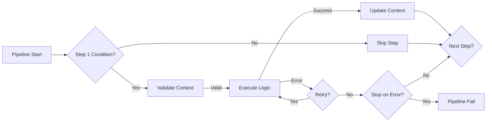

# PipelineFramework

**Version:** 1.0.0  
**Layer:** Application Orchestration (Layer 3)  
**Language:** TypeScript (strict, ES modules; Babel emits GAS V8 JavaScript)
**Dependencies:** CoreUtilsLib, GasResilienceLib (Optional)

## 🏗️ File and Folder Structure

Organized into core framework components and specialized step patterns:

```text
PipelineFramework/
├── src/
│   ├── Pipeline.ts             # The main orchestrator (Engine)
│   ├── PipelineContext.ts      # Shared state container with metadata and history
│   ├── Step.ts                 # Base class for all pipeline tasks
│   ├── errors/                 # Framework exceptions (Validation, Execution)
│   └── __tests__/              # Pipeline unit and integration tests
```

## 🧩 Programming Patterns

1.  **Chain of Responsibility Pattern**: The foundational pattern. Each step is a link in a chain that processes data and decides whether to pass it to the next step.
2.  **Template Method Pattern**: The `Step` base class defines the invariant execution logic (hooks, logging, validation) while leaving the specific task implementation to subclasses via the `_executeLogic` method.
3.  **Command Pattern**: Each `Step` is a command object that encapsulates everything needed to perform a task at a later time.
4.  **Observer Pattern**: The pipeline uses lifecycle hooks (`beforeStep`, `afterStep`, `onError`, `onComplete`) to allow external logic to observe and react to its execution.

## ⛓️ Overview

**PipelineFramework** is a lightweight, domain-agnostic engine for orchestrating sequential workflows in Google Apps Script. It implements the **Chain of Responsibility** pattern, allowing developers to break complex processes into small, reusable, and testable units called **Steps**.

Unlike a simple function chain, this framework provides a robust runtime environment with a shared **Context**, lifecycle hooks, execution history tracking, and optional integration with `GasResilienceLib` for automatic error recovery.

## ✨ Key Features

- **Sequential Execution**: Executes steps in a defined order, passing a mutable `PipelineContext` between them.
- **Shared State Management**: A robust `PipelineContext` object allows steps to read inputs and write outputs safely, with built-in metadata tracking.
- **Lifecycle Hooks**: Inject logic at specific points: `beforeStep`, `afterStep`, `onError`, and `onComplete`.
- **Conditional Execution**: Steps can decide whether to run or skip based on the current context state (`shouldExecute`).
- **Graceful Termination**: Steps can request the pipeline to stop early (`context.requestStop()`) without throwing errors.
- **Resilience Integration**: If `ExceptionService` is provided, steps automatically retry upon failure according to the configured strategy.

## 📦 Installation

```typescript
import { Pipeline, Step, PipelineContext } from '@PipelineFramework';
import { LoggerService } from '@CoreUtilsLib';
```

## 🚀 Quick Start

### 1. Create a Custom Step

Extend the `Step` class and implement `_executeLogic`.

```typescript
class FetchDataStep extends Step {
  constructor(logger) {
    super('FetchData', logger, {
      requiredKeys: ['sourceId'] // Auto-validates context before running
    });
  }

  _executeLogic(context) {
    const id = context.get('sourceId');
    // Perform logic...
    const data = { id, value: 100 };

    this.logger.info('Data fetched successfully');

    // Write result to context for next steps
    this.setResult(context, 'rawData', data);
  }
}
```

### 2. Build and Run Pipeline

```typescript
const logger = new LoggerService();
const pipeline = new Pipeline(logger);

pipeline
  .addStep(new FetchDataStep(logger))
  .addStep(new ProcessDataStep(logger))
  .addStep(new SaveDataStep(logger))
  .onComplete((context, success) => {
    console.log(`Pipeline finished. Success: ${success}`);
  });

// Execute with initial data
const finalContext = pipeline.execute({ sourceId: '12345' });
```

## 📚 API Reference

### 1. Pipeline

The orchestrator class.

- **`addStep(step)`**: Adds a step to the sequence.
- **`execute(initialData)`**: Starts the pipeline. Returns the final `PipelineContext`.
- **`clearSteps()`**: Resets the pipeline.
- **Hooks**:
  - `beforeStep((step, ctx) => ...)`
  - `afterStep((step, ctx, result) => ...)`
  - `onError((step, ctx, error) => ...)`
  - `onComplete((ctx, success) => ...)`

### 2. Step (Abstract)

Base class for all tasks.

- **`_executeLogic(context)`**: **[Abstract]** The core logic. Must be implemented by subclasses.
- **`shouldExecute(context)`**: Override to add conditional logic (returns `true`/`false`).
- **`setResult(context, key, value)`**: Helper to write to context and log the action.
- **`verifyContext(context)`**: Manually trigger validation of required keys.
- **Options**:
  - `requiredKeys`: Array of keys that must exist in context before execution.
  - `continueOnError`: If `true`, pipeline continues even if this step fails.

### 3. PipelineContext

The state container passed between steps.

- **`get(key, defaultValue)`**: Retrieve data.
- **`set(key, value)`**: Store data.
- **`has(key)`**: Check existence.
- **`requestStop(reason)`**: Signals the pipeline to stop after the current step finishes.
- **`getSummary()`**: Returns execution statistics (duration, steps completed/failed, history).

## 🛡️ Error Handling & Resilience

The framework handles errors at two levels:

1.  **Step Level**: If a step throws an error:
    - It is caught and wrapped in a `StepExecutionError`.
    - If `ExceptionService` was passed to the `Pipeline` constructor, the step is **automatically retried** (default 3 times).
    - If it still fails (or no resilience service is used), the `onError` hook is fired.
    - If `continueOnError` is false (default), the pipeline stops.

2.  **Validation Level**: If `requiredKeys` are missing, a `ContextValidationError` is thrown before `_executeLogic` is called.

## ⚙️ Architecture



## 🧪 Testing

Steps can be tested in isolation by mocking the `PipelineContext`.

### Unit Tests

```bash
npm test PipelineFramework
```

### Integration Tests

```bash
npm run test:integration
```

### Online Tests

The `__testOnline__` directory contains real-world tests that run in the Google Apps Script environment.
